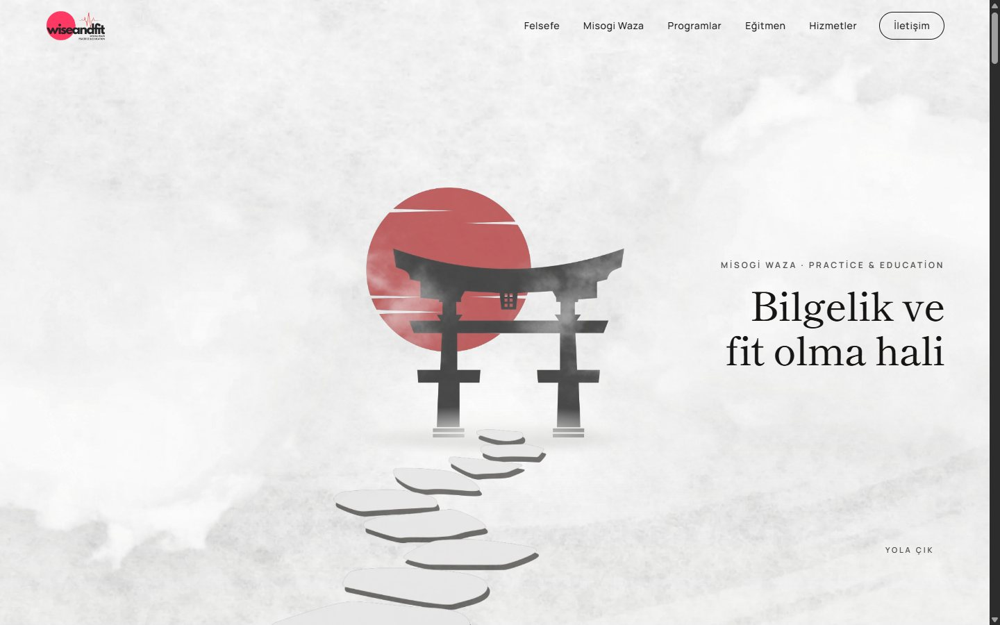
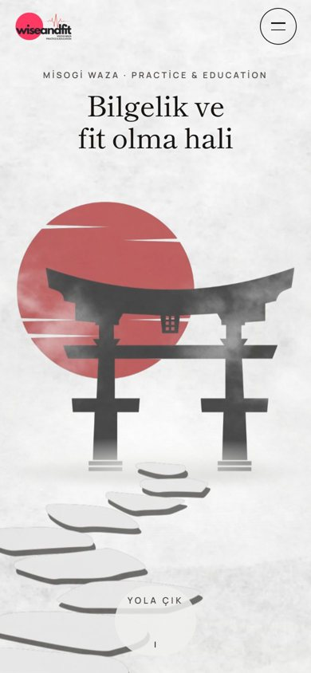
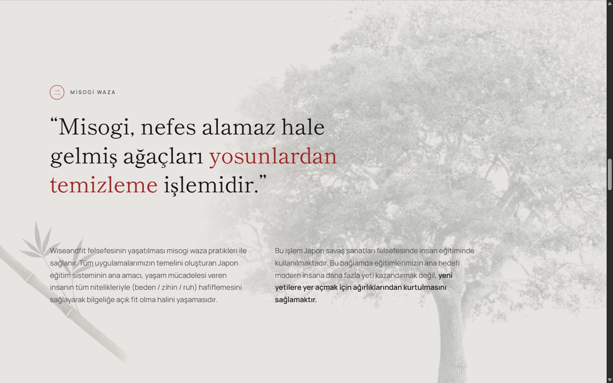

# Wiseandfit · Misogi Waza · Corporate Training Website (Demo)

**▶ Live demo: https://alex-buran.github.io/wiseandfit-website-demo/**

A redesign of a corporate training brand rooted in Japanese martial arts
philosophy. The hero is a layered paper-and-ink scene: clouds part on load,
the gate, path and background drift at different depths with the pointer, and
scrolling walks you up the stone path and through the torii into the page.
Below it: philosophy, the Misogi Waza section, five corporate programs, a
reference marquee, the trainer, services and contact. The 2026 program catalog
is rebuilt as a web page of A4 sheets that also prints and downloads as a PDF.

- `index.html`: the one-page site
- `katalog.html`: the 2026 catalog (screen, print and PDF)
- `screenshots/`: desktop and mobile captures

> **Sanitized portfolio demo.** Real e-mail, phone number, LinkedIn and YouTube
> links and structured data have been replaced with placeholders or removed,
> and the pages are set to noindex.

## Screenshots

| Desktop | Mobile | Misogi section |
|---|---|---|
|  |  |  |

Catalog: [`screenshots/catalog.jpg`](screenshots/catalog.jpg)

## Tech

- Static HTML / CSS / vanilla JavaScript, no build step
- GSAP + ScrollTrigger for the cloud intro and the scroll-scrubbed walk through the gate
- Pointer and device-tilt parallax, CSS masks and blend modes for the ink texture
- Container query units for the A4 catalog, `@page` print styles for the PDF
- Google Fonts (Shippori Mincho, Manrope, Noto Serif JP)
- Fully responsive · `prefers-reduced-motion` aware

## Design & build

Built for a real client; its source is kept in a private repository.

Designed and built by **[Softburn.tech](https://softburn.tech)**.
